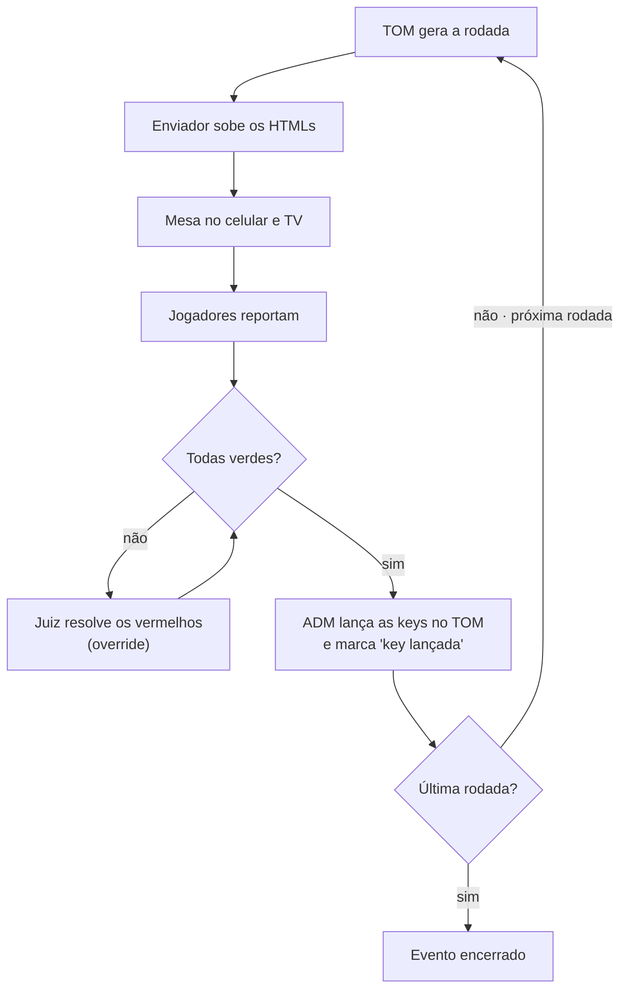

# Spec — Sistema de apoio a torneios Pokémon TCG (TOM)

Oct 20, 2026 · @Edduardo Souza Figueredo · revisão 2: Oct 21, 2026 · revisão 3: Oct 23, 2026

> **Revisão 2.** O sistema deixou de ser local-first e passou a ser 100% online. Os trechos marcados com **[R2]** mudaram nesta revisão; o registro completo está em "Registro de decisões", no fim do documento.
>
> **Revisão 3.** Login com conta Google (ou código por e-mail para quem não usa Google), confirmação na tela para troca de dispositivo e custo como critério principal. Trechos marcados com **[R3]**.
>
> **Revisão 4.** Login com e-mail e senha no lugar do código por e-mail; Google pronto para ativar. Trechos marcados com **[R4]**.

> **Revisão 5.** Player ID vale desde o cadastro, sem conferência do ADM; home pública da loja e política de privacidade. Trechos marcados com **[R5]**.

> **Revisão 6.** Juiz deixa de ser grupo do Cognito: é marca na conta, posta pelo ADM na Equipe, e só age no evento em que foi escalado. Trechos marcados com **[R6]**.

> **Revisão 7.** Ciclo do evento: QR na TV com inscrição automática, confirmação de presença que fecha o QR, rodada 1 só com todos confirmados, resultado final do TOM libera o encerramento. Trechos marcados com **[R7]**.

> **Revisão 8.** A pasta do TOM é conectada pelo navegador do ADM, no próprio painel do evento: sem token nem comando no notebook. O enviador por comando fica como plano B; um executável que roda em segundo plano fica como evolução.

## Visão e problema

O sistema é uma camada de auditoria de resultados entre os jogadores e o TOM: nenhuma rodada nova começa antes de todos os resultados da anterior estarem validados.

Hoje, se dois jogadores reportam vitória depois que a próxima rodada já foi iniciada no TOM, o pareamento fica comprometido e corrigir é difícil. O sistema resolve isso com três objetivos:

- Validar os resultados de cada rodada por consenso entre os jogadores, antes de lançá-los no TOM.
- Mostrar a cada jogador a mesa e o oponente em tempo real, no celular e numa TV do salão.
- Guardar o histórico de jogadores e resultados numa base própria, consultável pelo próprio jogador depois do evento. **[R2]**

O TOM continua sendo a fonte oficial. O sistema só lê os arquivos que ele gera e nunca escreve neles.

## Arquitetura geral **[R2]**

Tudo roda online, com HTTPS de ponta a ponta. A única peça local é o **enviador**: um programa pequeno no notebook do TOM que observa a pasta de HTMLs e faz upload de cada nova versão. Ele só lê a pasta e se autentica com um token por evento gerado pelo ADM (válido só para aquele evento, revogável).

**Ponto único de falha aceito.** Sem internet ninguém reporta. Plano de contingência:

- Roteador 4G de backup para o notebook do TOM e para o Wi-Fi do salão.
- O 4G de cada jogador funciona como rota alternativa natural.
- Se tudo cair, a guia de papel volta a ser o processo principal até a conexão voltar.

**Stack.** TypeScript de ponta a ponta, com os tipos de domínio compartilhados entre celular, TV, painel e API.

- Domínio puro (parser do TOM, termômetro, regras de resultado) em TypeScript sem nenhuma dependência de AWS. A AWS fica atrás de interfaces (inversão de dependência), então o núcleo roda e é testado sem nuvem.
- Arquitetura do repositório (camadas, pacotes e regra de dependência): ver `docs/adr/0001-arquitetura-do-repositorio.md`.
- AWS: Cognito (login com Google e códigos por e-mail) **[R3]**, Lambda com Function URL, sem API Gateway **[R3]**, DynamoDB, S3 (HTMLs brutos), CloudFront (site). Recursos, preços e projeções em "Recursos AWS e custos".
- **Custo é o critério principal [R3]:** entre opções que atendem a spec, vence a que consome menos recursos da AWS (o ideal é custo zero). Cada escolha de serviço vem com a diferença de custo e uma projeção por evento/mês.
- Escala: até 100 jogadores (50 mesas) por evento.

## Fontes de dados do TOM

O TOM grava um conjunto de HTMLs por torneio, com o nome do torneio como prefixo (ex.: `FODASEpairings.html`), e reescreve o mesmo arquivo a cada alteração. Cada versão é uma fotografia completa do estado, não um evento.

| Arquivo | O que traz | Uso no sistema |
| --- | --- | --- |
| match\_slips | Mesa, rodada, divisão, nomes, **Player ID** e as keys de resultado (vitória P1, vitória P2, empate) | Fonte principal: vínculo Player ID ↔ mesa e keys validadas para lançar no TOM |
| pairings | Rodada, mesa, nome e campanha (V/D/E); cada partida aparece duas vezes, uma de cada lado; bye | Conferência do pareamento e detecção de rodada nova |
| standings | Classificação, pontos, % de vitória dos oponentes | TV e histórico |
| matchrecord | Vitórias, derrotas e empates por jogador | Conferência |
| roster | Lista de jogadores, divisão; **sem Player ID** | Conferência |
| tournament\_details | Nome, local, data, organizador, formato, nº de rodadas | Metadados do torneio |
| brackets | Chave eliminatória (vazia nos testes) | A avaliar |

O `.tdf` só é gerado no início e no fim do evento e é o arquivo enviado para a Pokémon; o sistema não depende dele nem o altera.

A pasta acumula torneios; o sistema mostra sempre um só, o mais recente: o torneio com o arquivo modificado por último.

Nomes não servem como chave: dois jogadores podem ter o mesmo nome. A chave é sempre o Player ID.

Os HTMLs reais gerados pelo TOM 1.86 num torneio de teste ficam em `packages/tom-reports/test/fixtures/` e são a base dos testes do parser.

## Fluxo do evento **[R2]**

1. **Antes:** o jogador cria a conta online (a qualquer momento, inclusive em casa) entrando com a conta Google ou com e-mail e senha. **[R4]**
2. **Check-in:** no salão, o jogador faz login pelo QR. O ADM lança os jogadores no TOM. **[R5]** Não há conferência do Player ID pelo ADM.
   **[R7]** O ADM cria o evento (um ativo por vez) e a TV mostra o QR. Quem escaneia passa pelo login e pelo cadastro e fica inscrito sozinho. O ADM pede a confirmação de presença (o QR fecha na hora), digita no TOM os confirmados pelo painel de inscritos e só inicia a rodada 1 sem pendentes. Os standings da última rodada marcam o resultado final; aí o ADM encerra. A inscrição não decide quem reporta: continua valendo quem está nas guias do TOM.
3. **Rodadas:** o ciclo abaixo, uma vez por rodada.
4. **Depois:** resultados e histórico já estão online; o jogador consulta quando quiser.

Ao fim dos 30 minutos, as mesas cinza e laranja viram vermelhas e vão para o juiz; o ADM só lança as keys e inicia a próxima rodada com todas verdes.

## Resultados **[R2]**

O resultado guarda o **placar de games**, não só vitória, derrota ou empate. O desfecho (V/D/E) é derivado do placar.

| Tipo | Como surge |
| --- | --- |
| Vitória / derrota com placar (2x0, 2x1, 1x0...) | Reporte dos jogadores |
| Empate (inclusive empate em games, ex.: 1x1) | Reporte dos jogadores |
| Intentional draw (empate combinado) | Reporte dos jogadores (os dois marcam ID) |
| Double game loss (penalidade ou atraso dos dois) | Só por override do juiz/ADM |
| Vitória por ausência ou drop do oponente (2x0) | Só por override do juiz/ADM |
| Bye | Vem do TOM, já nasce verde |

O formato da partida (melhor de 1 ou melhor de 3) é configurado por evento e limita os placares possíveis.

Placares válidos: melhor de 3 aceita 2x0, 2x1, 1x0, 1x1 e 0x0; melhor de 1 aceita 1x0 e 0x0. Vitória por ausência vale 2x0 no melhor de 3 e 1x0 no melhor de 1. Double game loss não tem key na guia do TOM e é lançado à mão pelo ADM.

## Termômetro de validação de resultados **[R2]**

Cada mesa tem uma cor que indica a ação necessária; a próxima rodada só começa com todas as mesas verdes.

| Cor | Quando | Ação |
| --- | --- | --- |
| Cinza | Ninguém reportou ainda, dentro do tempo da rodada | Nenhuma, estado normal |
| Laranja | Só um lado reportou | Aguardar o outro lado |
| Verde | Os dois reportes se completam: desfechos opostos (vitória + derrota) ou empate + empate, **e o placar bate espelhado** (2x1 de um lado, 1x2 do outro); ou há override | Lançar a key no TOM |
| Vermelho | Conflito (vitória + vitória, derrota + derrota, empate + outro, placar divergente) ou mesa sem reporte ao fim do tempo | Juiz verifica; o painel mostra o motivo |

Regras:

- O bye já nasce verde, sem reporte.
- Tempo da rodada: 30 minutos por padrão, ajustável pelo ADM do evento. O cronômetro começa quando o ADM clica em "iniciar rodada", no anúncio do juiz.
- Ao fim do tempo, o que não estiver verde vira vermelho. Não há margem para turnos extras: essas mesas já estão com o juiz.
- Acréscimo de tempo numa mesa é lançado manualmente pelo juiz/ADM; essa mesa ganha prazo próprio.
- **Mesa vermelha por tempo volta a ficar verde sozinha** se os dois reportes coerentes chegarem depois. Vermelho por conflito também: se um jogador corrigir e os reportes passarem a bater, a mesa fica verde.
- **Verde trava a mesa para os jogadores.** Depois do verde, nenhum jogador corrige. Se os dois erraram e o resultado bateu, só o juiz ou o ADM corrigem, via override.
- **Key lançada trava em definitivo.** Quando o ADM marca "key lançada no TOM", a mesa fica fechada. Um override depois disso ainda é possível, mas o painel avisa que o TOM também precisa ser corrigido.
- **Override** (juiz ou ADM) é um evento à parte, com autor, motivo e horário, e prevalece sobre os reportes.
- O jogador só reporta depois que o ADM inicia a rodada. Correção de reporte é um novo reporte do mesmo jogador: vale o último, e os anteriores ficam no histórico.
- O pareamento pode ser republicado pelo TOM até a rodada começar; depois disso não muda mais (correção de pareamento no meio da rodada fica para evolução).
- A rodada seguinte só pode ser iniciada com todas as keys da anterior marcadas como lançadas.
- Um dispositivo por pessoa. Jogador sem celular: o ADM reporta por ele no painel. Se os dois jogadores da mesa estão sem celular, o ADM media e lança o resultado.
- Antes de o ADM iniciar a rodada, nenhuma mesa fica vermelha por tempo. Com conflito e tempo esgotado ao mesmo tempo, o motivo mostrado é o conflito.
- Intentional draw só bate com intentional draw; contra um empate em games (ex.: 0x0) é conflito.

## Telas **[R2]**

São três visões do mesmo estado, todas servidas online.

| Tela | Quem vê | O que mostra |
| --- | --- | --- |
| Celular do jogador | Só o jogador logado | Mesa e oponente da rodada atual (ex.: Mesa 1 — você x teste2), botões de reporte com placar e, fora do evento, o histórico do jogador |
| TV do salão | Todos | Todos os pareamentos e o cronômetro da rodada; atende jogadores sem celular e o juiz |
| Painel do ADM / juiz | Organização | Termômetro por mesa, motivo dos vermelhos, override, keys validadas, "key lançada", iniciar rodada, acréscimo por mesa, reporte em nome do jogador, desfazer vínculo de Player ID **[R5]**, Equipe (marcar juiz) e escala de juízes no evento **[R6]** |

Atualização no celular: na primeira versão, por consulta periódica à API (polling) e atualização manual. Com o sistema online, notificação push (Web Push) e conexão aberta (WebSocket) passam a ser possíveis numa evolução.

O celular precisa deixar claro quando um reporte **não** foi enviado. Nunca mostrar sucesso falso.

## Identidade, acesso e segurança **[R2]**

**Papéis.** Jogador, juiz e ADM são papéis diferentes. **[R6]** O juiz é uma conta de jogador marcada pelo ADM na Equipe e só age no evento em que foi escalado; nesse evento não reporta como jogador.

| Ação | Jogador | Juiz | ADM |
| --- | --- | --- | --- |
| Reportar pela própria mesa | ✓ | | |
| Override de resultado (inclui DGL e vitória por ausência/drop) | | ✓ | ✓ |
| Acréscimo de tempo na mesa | | ✓ | ✓ |
| Reportar em nome de jogador sem celular | | | ✓ |
| Iniciar rodada, marcar "key lançada" | | | ✓ |
| Desfazer vínculo de Player ID **[R5]**, Equipe e escala de juízes **[R6]**, gerar token do enviador, configurar evento | | | ✓ |

**Conta e Player ID.**

- **[R4]** O jogador cria a conta online entrando com a **conta Google** ou com **e-mail e senha**. O cadastro com senha é confirmado na hora, sem código por e-mail (o e-mail não é verificado; risco aceito). O único e-mail enviado é o de "Esqueci minha senha".
- Uma conta por e-mail; na v1 um responsável não gerencia mais de uma conta.
- **[R4]** Quem entra pelo Google e também por e-mail e senha continua com uma conta só: no primeiro acesso pelo Google, a conta é encontrada pelo e-mail e o login do Google é ligado a ela. Como a senha não prova o e-mail, um login por senha nunca é ligado a uma conta existente ("Esse e-mail já tem conta"). Numa conta criada com senha, o primeiro acesso pelo Google prova o dono e retira os logins de senha: quem cadastrou o e-mail de outra pessoa perde o acesso. O Google só é aceito com e-mail verificado.
- **[R5]** O Player ID trava na hora do cadastro: o primeiro a cadastrar fica com ele. Quem tenta um Player ID em uso vê "Esse Player ID já está em uso, procure o ADM". Conta sem Player ID (ex.: entrou pelo Google) informa depois; para trocar um Player ID já cadastrado, só o ADM.
- **[R5]** Se alguém cadastrou o Player ID de outra pessoa, o ADM usa **"Desfazer vínculo"**: o Player ID sai da conta errada (que continua existindo, mas não age) e o dono verdadeiro pode cadastrá-lo. Fica registrado como evento de auditoria (autor, horário, conta afetada).

**Sessão única e dispositivo.**

- Cada conta tem um único dispositivo ativo. Não há duas sessões simultâneas, então ninguém reporta pela conta de outro em paralelo.
- **[R3]** No primeiro acesso a sessão é ativada direto. Ao entrar num dispositivo novo com outro já ativo, o jogador confirma na tela ("entrar aqui desconecta o outro dispositivo") e o anterior é revogado na hora. Quem entra por e-mail já recebe um código a cada login num dispositivo novo; quem entra pelo Google já provou o e-mail no próprio Google.
- A revogação vale na hora: a API guarda a sessão ativa de cada conta e recusa tokens de outra sessão, mesmo que ainda não tenham expirado. O token de acesso dura 15 minutos.
- Só e-mail na v1 (sem SMS). O remetente dos e-mails (domínio próprio ou não) e o acesso de produção do SES são definidos antes do primeiro evento.

**Transporte.** HTTPS em tudo, desde o início.

## Dados pessoais e LGPD **[R2]**

Dados guardados: nome, Player ID, e-mail, ano de nascimento (suficiente para as divisões Júnior, Sênior e Máster) e telefone (opcional).

O consentimento dado à Pokémon na criação do Player ID não cobre a base própria do organizador. O cadastro terá:

- Um texto curto dizendo para que os dados são usados (organização do torneio, histórico de participações e ranking futuro, sem compartilhamento com terceiros).
- Para menores, o checkbox "Sou o responsável legal por este jogador e autorizo o uso dos dados acima". Para menores de 12 anos o consentimento do responsável é obrigatório (LGPD, art. 14); na v1 cada conta usa um e-mail próprio, então um responsável com dois filhos usa dois e-mails.
- Um contato e uma opção para pedido de exclusão dos dados.

**Retenção.** Todos os dados têm prazo de validade (TTL) de **24 meses**: a conta expira após 24 meses sem participar de evento, e os resultados expiram 24 meses após o torneio. O ranking futuro fica limitado a essa janela. Pedido de exclusão apaga antes do prazo.

## Recursos AWS e custos **[R3]**

Tudo em us-east-2 (região única do projeto AWS). Cada recurso de produção tem um gêmeo descartável usado só nos testes reais (`npm run test:aws`), com retenção de 1 dia. Preços oficiais conferidos em Oct 23, 2026 (região da AWS nos EUA); projeção para 100 jogadores e 1 evento por mês.

| Recurso | Stack (produção / testes) | Para quê | Preço | Projeção/mês |
| --- | --- | --- | --- | --- |
| DynamoDB `Events` (sob demanda, TTL 24 meses, PITR em produção) | TomData / TomTest | Eventos das rodadas | US$ 0,625 por milhão de escritas, US$ 0,125 por milhão de leituras; 25 GB grátis; PITR US$ 0,20/GB-mês | < US$ 0,10 |
| DynamoDB `Accounts` (idem) | TomData / TomTest | Contas, auditoria de identidade e trava do Player ID | idem | < US$ 0,01 |
| DynamoDB `Tournaments` (idem) | TomData / TomTest | Eventos do ADM, trava do token do enviador, rodada atual | idem | < US$ 0,01 |
| S3 `Snapshots` (nome fixo, privado, SSE-S3, só HTTPS, expira em 24 meses) | TomData / TomTest | Fotografias dos HTMLs do TOM | US$ 0,023/GB-mês; US$ 0,005 por mil gravações | < US$ 0,01 |
| Cognito user pool, plano Essentials | TomAuth / TomAuthTest | Login (e-mail e senha; Google), grupos admin e judge | 10 mil usuários ativos/mês grátis; depois US$ 0,015 cada | US$ 0 |
| Lambda `PreSignUp` (Node 22, Arm, 128 MB, inline) **[R4]** | TomAuth / TomAuthTest | Confirma o cadastro com senha na hora, sem e-mail | Franquia mensal da Lambda | US$ 0 |
| E-mail do Cognito (padrão, sem SES) | TomAuth | Só o código do "Esqueci minha senha" **[R4]** | Grátis; limite de ~50 e-mails/dia | US$ 0 |
| Lambda `Handler` (Node 22, Arm, 256 MB) | TomApi / TomApiTest | API inteira (roteador único) | US$ 0,20 por milhão + US$ 0,0000133/GB-s; 1 milhão de execuções e 400 mil GB-s grátis por mês | US$ 0 |
| Lambda Function URL | TomApi / TomApiTest | Endereço HTTPS da API, sem API Gateway | Sem cobrança própria | US$ 0 |
| CloudWatch Logs (14 dias) | TomApi / TomApiTest | Logs da Lambda | 5 GB/mês grátis; depois ~US$ 0,50/GB | US$ 0 |
| CloudFront + S3 `Site` | TomWeb | Site (celular, TV, ADM) e `/api` no mesmo endereço | 1 TB e 10 milhões de requisições/mês grátis, permanentemente | US$ 0 |
| CloudFront Function `SpaRoutes` | TomWeb | Rotas do app (`/tv`) servem o `index.html` sem mexer nos erros da API | 2 milhões de execuções/mês grátis | US$ 0 |
| Bootstrap do CDK (`CDKToolkit`) | — | Bucket de assets e roles de deploy | S3 e ECR mínimos | ~US$ 0 |

**Total projetado: menos de US$ 0,20/mês**, coberto pelos créditos do Free plan (US$ 100, até abril de 2027).

Escolhas feitas por custo:

- **Function URL em vez de API Gateway:** o HTTP API custaria US$ 1,00 por milhão de chamadas (franquia só nos primeiros 12 meses); a Function URL só cobra a Lambda, que tem franquia mensal permanente. O token é validado no código (`aws-jwt-verify`); a cota de 10 execuções simultâneas da conta limita o gasto em caso de abuso.
- **Cognito Essentials:** necessário para o código por e-mail; custo zero até 10 mil usuários ativos/mês. O plano Plus (proteção contra ameaças) custaria US$ 0,02 por usuário, sem franquia.
- **Lambda em Arm com 256 MB:** ~20% mais barata que x86; pacote de 27 KB (o SDK da AWS vem no runtime).
- **Logs por 14 dias** e **TTL** em tabelas e bucket: nada acumula custo de armazenamento.
- **Quadro da TV guardado 5 s no CloudFront** (`/api/board`): dezenas de TVs e celulares olhando viram uma chamada à Lambda a cada 5 s por borda, em vez de uma por tela.
- **Site publicado por script** (`npm run web:deploy`), sem a Lambda e a layer extras do `BucketDeployment` do CDK.

Pontos de atenção:

- **DynamoDB sob demanda não tem requisições grátis**; a franquia permanente (25 unidades de leitura e 25 de escrita) só vale no modo provisionado. O polling da fase 7 (~290 mil chamadas por evento) é o maior consumidor previsto; a fase 7 avalia cache e o modo provisionado para chegar a custo zero.
- **SES:** remetente e acesso de produção definidos antes do primeiro evento (US$ 0,10 por mil e-mails; ~US$ 0,02/mês).
- O Free plan termina em abril de 2027; depois disso a conta precisa passar para o plano pago para continuar.

## Resiliência **[R2]**

- Cada reporte é gravado no banco antes de o celular receber o "ok"; nada fica só em memória.
- O estado de cada mesa é recalculado a partir dos eventos gravados.
- O cronômetro guarda o horário de início da rodada, não uma contagem.
- O enviador relê a pasta do TOM ao iniciar e reenvia o que estiver mais novo que a última versão enviada.
- Os reportes servem também de registro independente da rodada, caso o TOM perca dados.
- Contingência: roteador 4G de backup e guia de papel (ver "Arquitetura geral"). O notebook do TOM tem bateria própria.

## Dados e histórico **[R2]**

Todo toque vira um evento gravado, e o que as telas mostram é estado calculado em cima desses eventos.

- **Eventos:** reporte (conta, Player ID, torneio, rodada, mesa, placar, horário), correção de reporte, override (autor, papel, motivo), acréscimo de tempo, início de rodada, key lançada, check-in, Player ID informado e vínculo desfeito **[R5]**, troca de dispositivo.
- **Fotografias do TOM:** cada nova versão dos HTMLs vai para o S3, particionada por torneio e data, e o histórico sai da comparação entre versões (rodada nova, resultado lançado, drop).
- **Divisões:** o modelo de dados já leva a divisão na chave da mesa, mesmo que a v1 trate um evento com uma divisão só.
- **Preparado para ranking:** o ranking não entra agora, mas os dados guardados já permitem calculá-lo depois sem migração: placar por partida, data do torneio, colocação final (standings), presença e divisão. O critério (pontos por vitória, presença, colocação) fica para a fase do ranking.

Exemplos de análise depois: conflitos por evento, mesas que mais demoram, tempo médio para fechar uma rodada, evolução de cada jogador entre eventos, premiação de jogador do mês.

## Ordem de construção **[R2]**

Uma fase por vez; cada fase tem os próprios testes e só começa a próxima depois de validada.

| Fase | Entrega | Precisa de AWS? |
| --- | --- | --- |
| 0 | Repositório git, estrutura TypeScript, lint, testes rodando | Não |
| 1 | Parser dos HTMLs do TOM (função pura, testada com as fixtures reais) | Não |
| 2 | Regras de resultado e termômetro (puro) | Não |
| 3 | Modelo de eventos e recálculo do estado (repositório em memória, atrás de interface) | Não |
| 4 | Enviador: observar a pasta do TOM e detectar escrita completa | Não |
| 5 | Infraestrutura AWS como código, IAM mínimo, adaptadores DynamoDB e S3 | Sim |
| 6 | Login, papéis, sessão única, troca de dispositivo, Player ID **[R5]** | Sim |
| 7 | **[R3]** Celular do jogador: 7.1 site e login; 7.2 envio do enviador para a API com token do evento (antes fase 10); 7.3 rodada atual, reporte e atualização automática | Sim |
| 8–9 | Telas: TV e painel do ADM / juiz | Sim |

## Decisões em aberto e fora de escopo

Em aberto:

- [x] Dependência do match_slips: as guias são obrigatórias em toda rodada com mesas. Sem elas (ou com guias de outra rodada), o pareamento é recusado e o sistema pede para gerar as guias no TOM. Sem fallback por nome na v1.
- [x] Como o enviador percebe que o TOM terminou de escrever: o arquivo fica sem mudar de tamanho e data por 1,5 s e termina em `</html>`. A pasta é lida por polling a cada 1 s (o `fs.watch` perde eventos no Windows/OneDrive). Todos os HTMLs do evento mais recente são enviados, inclusive brackets; conteúdo idêntico (mesmo SHA-256) não é reenviado. A frequência real de regravação do TOM sai do log do enviador num evento real.
- [x] Login com Google **[R4]**: pronto no código e na infra; ativado com o cadastro do provedor no Cognito e a flag `google` (README, "Ativar o Google"). Publicar o app no Google exige home e política de privacidade públicas.
- [ ] Remetente dos e-mails e acesso de produção do SES **[R3]**: necessários antes do primeiro evento (limite atual de ~50 e-mails/dia) e para o e-mail do código de login em português.
- [ ] Estética das telas (celular, TV, painel): o layout atual é funcional; o visual será revisto com as três telas lado a lado.
- [ ] Top cut / eliminatória (arquivo brackets).
- [ ] Critério do ranking (fase futura).
- [ ] Histórico do jogador fora do evento (torneios, rodadas, oponentes e placares): fica para uma próxima spec. Os dados já ficam guardados (eventos das rodadas e fotografias do TOM), então nada se perde até lá.
- [ ] Atualização em tempo real no celular sem polling (evolução).

Fora de escopo:

- Escrever no TOM ou no `.tdf`. O lançamento das keys no TOM continua manual.
- Substituir o TOM ou o envio oficial de resultados para a Pokémon.
- Funcionamento offline no dia do evento (substituído pela contingência com 4G e guia de papel).
- SMS e responsável com várias contas (v1).

## Registro de decisões

### Revisão 2 — Oct 21, 2026

| # | Antes | Agora |
| --- | --- | --- |
| 1 | Servidor local, funciona sem internet, sincroniza com o online | 100% online na AWS; só o enviador roda no notebook do TOM |
| 2 | HTTP na rede local | HTTPS desde o início |
| 3 | Celular vinculado ao Player ID digitado no cadastro | Conta com e-mail verificado; vínculo com Player ID confirmado pelo ADM no primeiro check-in |
| 4 | Sem regra de sessão | Sessão única por conta; dispositivo novo exige código por e-mail e revoga o anterior |
| 5 | Um dispositivo reporta por vários jogadores (pai com dois filhos) | Um dispositivo por pessoa; sem celular, o ADM reporta e media |
| 6 | Resultado V/D/E | Placar de games; ID, DGL e vitória por ausência/drop |
| 7 | Jogador corrige até a validação | Verde trava para o jogador; key lançada trava em definitivo; juiz e ADM corrigem via override |
| 8 | Vermelho só sai pelo juiz | Vermelho por tempo ou conflito volta a verde sozinho com reportes coerentes |
| 9 | Juiz e ADM sem distinção | Papéis separados com permissões diferentes |
| 10 | Dados: nome e Player ID | Nome, Player ID, e-mail, ano de nascimento, telefone opcional; TTL de 24 meses |
| 11 | Stack em aberto | TypeScript de ponta a ponta; Cognito, API Gateway, Lambda, DynamoDB, S3, CloudFront |
| 12 | Uma divisão | Modelo preparado para várias divisões e para ranking futuro |

### Revisão 3 — Oct 23, 2026

| # | Antes | Agora |
| --- | --- | --- |
| 1 | Conta com e-mail verificado | Login com conta Google; alternativa sem senha com código por e-mail para quem não usa Google |
| 2 | Dispositivo novo exige código por e-mail | Dispositivo novo pede confirmação na tela e revoga o anterior na hora; o código por e-mail fica só no login de quem não usa Google |
| 3 | Custo não era critério explícito | Menor custo (ideal zero) é o critério principal; cada escolha traz diferença de custo e projeção |
| 4 | API Gateway + Lambda | Lambda com Function URL (sem API Gateway); token validado no código |
| 5 | Conta = usuário do Cognito | Conta com id próprio e vários logins (Google, código por e-mail) unificados pelo e-mail verificado |
| 6 | Envio do enviador para a API na fase 10 | Na fase 7: as telas usam desde o início o fluxo real TOM → enviador → API, sem carga manual |
| 7 | Telas em aberto | Preact + Vite; site estático no S3 com CloudFront, API em `/api` no mesmo endereço |

### Revisão 4 — Oct 24, 2026

| # | Antes | Agora |
| --- | --- | --- |
| 1 | Código de uso único por e-mail para quem não usa Google | E-mail e senha, cadastro confirmado na hora (gatilho de pré-cadastro); o limite de ~50 e-mails/dia do Cognito não comporta 100 jogadores entrando no mesmo dia |
| 2 | E-mail verificado em toda conta | Só o Google prova o e-mail; o e-mail serve apenas para o "Esqueci minha senha" |
| 3 | Qualquer login novo é ligado pela conta do mesmo e-mail | Só o Google liga; senha num e-mail que já tem conta é recusada |
| 4 | Token de renovação de 30 dias | 365 dias: o jogador não digita a senha a cada evento mensal |

### Revisão 5 — Oct 24, 2026

| # | Antes | Agora |
| --- | --- | --- |
| 1 | Player ID só vale depois que o ADM confere no primeiro check-in | Vale no cadastro; o primeiro a cadastrar fica com ele; o ADM desfaz vínculos errados |
| 2 | Site só com a área logada | Home pública da loja (`/`), política de privacidade (`/privacidade`) e área logada em `/conta` |
| 3 | Canal do titular (LGPD) não definido | Direct do Instagram `@goodgame.tcg`, resposta em até 15 dias |

### Revisão 6 — Oct 24, 2026

| # | Antes | Agora |
| --- | --- | --- |
| 1 | Juiz era grupo do Cognito, com poder em qualquer evento | Marca na conta (Equipe do ADM) + escala por evento; tirar da equipe corta o poder na hora |
| 2 | Pool do Cognito com e-mail fixo | E-mail alterável: o Google regrava o e-mail a cada login e o segundo login falhava; pool novo, login em `ggtcg-login` |

### Revisão 7 — Oct 24, 2026

| # | Antes | Agora |
| --- | --- | --- |
| 1 | Evento era só o token do enviador | Evento com fases (inscrições abertas, confirmando presença, em andamento, resultado final, encerrado ou cancelado), data e tempo de rodada; um ativo por vez |
| 2 | Jogadores lançados no TOM sem lista | QR na TV inscreve sozinho; painel de inscritos com Player ID, nome e ano para digitar no TOM |
| 3 | Rodada 1 iniciava a qualquer momento | Só depois de pedir a confirmação de presença e com nenhum pendente |
| 4 | TV só com a rodada | TV por fase: espera, QR, confirmação, rodada e classificação final |

### Revisão 8 — Oct 24, 2026

| # | Antes | Agora |
| --- | --- | --- |
| 1 | Enviador por comando no PowerShell, com token copiado da tela | O ADM conecta a pasta do TOM no painel (Chrome ou Edge) e o site envia sozinho para o evento ativo, com o login do ADM |
| 2 | — | Evolução: executável no notebook, pareado pelo painel, rodando em segundo plano |
