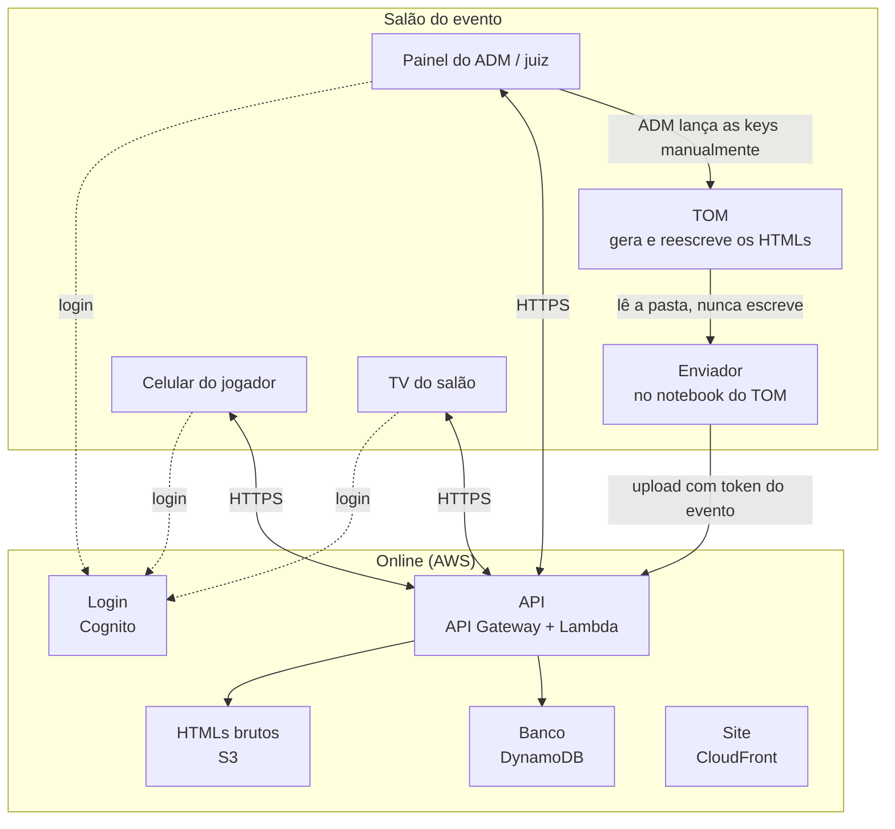
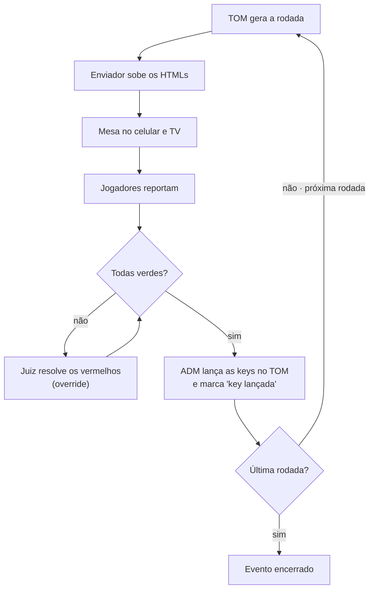

# Spec — Sistema de apoio a torneios Pokémon TCG (TOM)

Oct 20, 2026 · @Edduardo Souza Figueredo · revisão 2: Oct 21, 2026

> **Revisão 2.** O sistema deixou de ser local-first e passou a ser 100% online. Os trechos marcados com **[R2]** mudaram nesta revisão; o registro completo está em "Registro de decisões", no fim do documento.

## Visão e problema

O sistema é uma camada de auditoria de resultados entre os jogadores e o TOM: nenhuma rodada nova começa antes de todos os resultados da anterior estarem validados.

Hoje, se dois jogadores reportam vitória depois que a próxima rodada já foi iniciada no TOM, o pareamento fica comprometido e corrigir é difícil. O sistema resolve isso com três objetivos:

- Validar os resultados de cada rodada por consenso entre os jogadores, antes de lançá-los no TOM.
- Mostrar a cada jogador a mesa e o oponente em tempo real, no celular e numa TV do salão.
- Guardar o histórico de jogadores e resultados numa base própria, consultável pelo próprio jogador depois do evento. **[R2]**

O TOM continua sendo a fonte oficial. O sistema só lê os arquivos que ele gera e nunca escreve neles.

## Arquitetura geral **[R2]**

Tudo roda online, com HTTPS de ponta a ponta. A única peça local é o **enviador**: um programa pequeno no notebook do TOM que observa a pasta de HTMLs e faz upload de cada nova versão. Ele só lê a pasta e se autentica com um token por evento gerado pelo ADM (válido só para aquele evento, revogável).

**Ponto único de falha aceito.** Sem internet ninguém reporta. Plano de contingência:

- Roteador 4G de backup para o notebook do TOM e para o Wi-Fi do salão.
- O 4G de cada jogador funciona como rota alternativa natural.
- Se tudo cair, a guia de papel volta a ser o processo principal até a conexão voltar.

**Stack.** TypeScript de ponta a ponta, com os tipos de domínio compartilhados entre celular, TV, painel e API.

- Domínio puro (parser do TOM, termômetro, regras de resultado) em TypeScript sem nenhuma dependência de AWS. A AWS fica atrás de interfaces (inversão de dependência), então o núcleo roda e é testado sem nuvem.
- Arquitetura do repositório (camadas, pacotes e regra de dependência): ver `docs/adr/0001-arquitetura-do-repositorio.md`.
- AWS: Cognito (login e códigos por e-mail), API Gateway + Lambda, DynamoDB, S3 (HTMLs brutos), CloudFront (site).
- Escala: até 100 jogadores (50 mesas) por evento. Os serviços "sempre gratuitos" cobrem isso com folga; as condições do Free Tier para contas novas mudaram em 2025 e devem ser conferidas na criação da conta.

## Fontes de dados do TOM

O TOM grava um conjunto de HTMLs por torneio, com o nome do torneio como prefixo (ex.: `FODASEpairings.html`), e reescreve o mesmo arquivo a cada alteração. Cada versão é uma fotografia completa do estado, não um evento.

| Arquivo | O que traz | Uso no sistema |
| --- | --- | --- |
| match\_slips | Mesa, rodada, divisão, nomes, **Player ID** e as keys de resultado (vitória P1, vitória P2, empate) | Fonte principal: vínculo Player ID ↔ mesa e keys validadas para lançar no TOM |
| pairings | Rodada, mesa, nome e campanha (V/D/E); cada partida aparece duas vezes, uma de cada lado; bye | Conferência do pareamento e detecção de rodada nova |
| standings | Classificação, pontos, % de vitória dos oponentes | TV e histórico |
| matchrecord | Vitórias, derrotas e empates por jogador | Conferência |
| roster | Lista de jogadores, divisão; **sem Player ID** | Conferência |
| tournament\_details | Nome, local, data, organizador, formato, nº de rodadas | Metadados do torneio |
| brackets | Chave eliminatória (vazia nos testes) | A avaliar |

O `.tdf` só é gerado no início e no fim do evento e é o arquivo enviado para a Pokémon; o sistema não depende dele nem o altera.

A pasta acumula torneios; o sistema mostra sempre um só, o mais recente: o torneio com o arquivo modificado por último.

Nomes não servem como chave: dois jogadores podem ter o mesmo nome. A chave é sempre o Player ID.

Os HTMLs reais gerados pelo TOM 1.86 num torneio de teste ficam em `packages/tom-reports/test/fixtures/` e são a base dos testes do parser.

## Fluxo do evento **[R2]**

1. **Antes:** o jogador cria a conta online (a qualquer momento, inclusive em casa) e verifica o e-mail.
2. **Check-in:** no salão, o jogador faz login pelo QR. No primeiro evento, o ADM confirma presencialmente que o Player ID é dele. O ADM lança os jogadores no TOM.
3. **Rodadas:** o ciclo abaixo, uma vez por rodada.
4. **Depois:** resultados e histórico já estão online; o jogador consulta quando quiser.

Ao fim dos 30 minutos, as mesas cinza e laranja viram vermelhas e vão para o juiz; o ADM só lança as keys e inicia a próxima rodada com todas verdes.

## Resultados **[R2]**

O resultado guarda o **placar de games**, não só vitória, derrota ou empate. O desfecho (V/D/E) é derivado do placar.

| Tipo | Como surge |
| --- | --- |
| Vitória / derrota com placar (2x0, 2x1, 1x0...) | Reporte dos jogadores |
| Empate (inclusive empate em games, ex.: 1x1) | Reporte dos jogadores |
| Intentional draw (empate combinado) | Reporte dos jogadores (os dois marcam ID) |
| Double game loss (penalidade ou atraso dos dois) | Só por override do juiz/ADM |
| Vitória por ausência ou drop do oponente (2x0) | Só por override do juiz/ADM |
| Bye | Vem do TOM, já nasce verde |

O formato da partida (melhor de 1 ou melhor de 3) é configurado por evento e limita os placares possíveis.

Placares válidos: melhor de 3 aceita 2x0, 2x1, 1x0, 1x1 e 0x0; melhor de 1 aceita 1x0 e 0x0. Vitória por ausência vale 2x0 no melhor de 3 e 1x0 no melhor de 1. Double game loss não tem key na guia do TOM e é lançado à mão pelo ADM.

## Termômetro de validação de resultados **[R2]**

Cada mesa tem uma cor que indica a ação necessária; a próxima rodada só começa com todas as mesas verdes.

| Cor | Quando | Ação |
| --- | --- | --- |
| Cinza | Ninguém reportou ainda, dentro do tempo da rodada | Nenhuma, estado normal |
| Laranja | Só um lado reportou | Aguardar o outro lado |
| Verde | Os dois reportes se completam: desfechos opostos (vitória + derrota) ou empate + empate, **e o placar bate espelhado** (2x1 de um lado, 1x2 do outro); ou há override | Lançar a key no TOM |
| Vermelho | Conflito (vitória + vitória, derrota + derrota, empate + outro, placar divergente) ou mesa sem reporte ao fim do tempo | Juiz verifica; o painel mostra o motivo |

Regras:

- O bye já nasce verde, sem reporte.
- Tempo da rodada: 30 minutos por padrão, ajustável pelo ADM do evento. O cronômetro começa quando o ADM clica em "iniciar rodada", no anúncio do juiz.
- Ao fim do tempo, o que não estiver verde vira vermelho. Não há margem para turnos extras: essas mesas já estão com o juiz.
- Acréscimo de tempo numa mesa é lançado manualmente pelo juiz/ADM; essa mesa ganha prazo próprio.
- **Mesa vermelha por tempo volta a ficar verde sozinha** se os dois reportes coerentes chegarem depois. Vermelho por conflito também: se um jogador corrigir e os reportes passarem a bater, a mesa fica verde.
- **Verde trava a mesa para os jogadores.** Depois do verde, nenhum jogador corrige. Se os dois erraram e o resultado bateu, só o juiz ou o ADM corrigem, via override.
- **Key lançada trava em definitivo.** Quando o ADM marca "key lançada no TOM", a mesa fica fechada. Um override depois disso ainda é possível, mas o painel avisa que o TOM também precisa ser corrigido.
- **Override** (juiz ou ADM) é um evento à parte, com autor, motivo e horário, e prevalece sobre os reportes.
- Um dispositivo por pessoa. Jogador sem celular: o ADM reporta por ele no painel. Se os dois jogadores da mesa estão sem celular, o ADM media e lança o resultado.
- Antes de o ADM iniciar a rodada, nenhuma mesa fica vermelha por tempo. Com conflito e tempo esgotado ao mesmo tempo, o motivo mostrado é o conflito.
- Intentional draw só bate com intentional draw; contra um empate em games (ex.: 0x0) é conflito.

## Telas **[R2]**

São três visões do mesmo estado, todas servidas online.

| Tela | Quem vê | O que mostra |
| --- | --- | --- |
| Celular do jogador | Só o jogador logado | Mesa e oponente da rodada atual (ex.: Mesa 1 — você x teste2), botões de reporte com placar e, fora do evento, o histórico do jogador |
| TV do salão | Todos | Todos os pareamentos e o cronômetro da rodada; atende jogadores sem celular e o juiz |
| Painel do ADM / juiz | Organização | Termômetro por mesa, motivo dos vermelhos, override, keys validadas, "key lançada", iniciar rodada, acréscimo por mesa, reporte em nome do jogador, confirmação de Player ID |

Atualização no celular: na primeira versão, por consulta periódica à API (polling) e atualização manual. Com o sistema online, notificação push (Web Push) e conexão aberta (WebSocket) passam a ser possíveis numa evolução.

O celular precisa deixar claro quando um reporte **não** foi enviado. Nunca mostrar sucesso falso.

## Identidade, acesso e segurança **[R2]**

**Papéis.** Jogador, juiz e ADM são papéis diferentes:

| Ação | Jogador | Juiz | ADM |
| --- | --- | --- | --- |
| Reportar pela própria mesa | ✓ | | |
| Override de resultado (inclui DGL e vitória por ausência/drop) | | ✓ | ✓ |
| Acréscimo de tempo na mesa | | ✓ | ✓ |
| Reportar em nome de jogador sem celular | | | ✓ |
| Iniciar rodada, marcar "key lançada" | | | ✓ |
| Confirmar Player ID no check-in, gerar token do enviador, configurar evento | | | ✓ |

**Conta e Player ID.**

- O jogador cria a conta online com e-mail verificado. Uma conta por e-mail; na v1 um responsável não gerencia mais de uma conta.
- O vínculo conta ↔ Player ID só fica ativo depois que o ADM confirma presencialmente, no primeiro check-in. Isso impede alguém de registrar o Player ID de outra pessoa antes dela. Depois da confirmação, não precisa repetir.

**Sessão única e dispositivo.**

- Cada conta tem um único dispositivo ativo. Não há duas sessões simultâneas, então ninguém reporta pela conta de outro em paralelo.
- Login num dispositivo novo exige um código enviado ao e-mail da conta. Ao confirmar, o dispositivo antigo é revogado na hora.
- Só e-mail na v1 (sem SMS).

**Transporte.** HTTPS em tudo, desde o início.

## Dados pessoais e LGPD **[R2]**

Dados guardados: nome, Player ID, e-mail, ano de nascimento (suficiente para as divisões Júnior, Sênior e Máster) e telefone (opcional).

O consentimento dado à Pokémon na criação do Player ID não cobre a base própria do organizador. O cadastro terá:

- Um texto curto dizendo para que os dados são usados (organização do torneio, histórico de participações e ranking futuro, sem compartilhamento com terceiros).
- Para menores, o checkbox "Sou o responsável legal por este jogador e autorizo o uso dos dados acima". Para menores de 12 anos o consentimento do responsável é obrigatório (LGPD, art. 14); na v1 cada conta usa um e-mail próprio, então um responsável com dois filhos usa dois e-mails.
- Um contato e uma opção para pedido de exclusão dos dados.

**Retenção.** Todos os dados têm prazo de validade (TTL) de **24 meses**: a conta expira após 24 meses sem participar de evento, e os resultados expiram 24 meses após o torneio. O ranking futuro fica limitado a essa janela. Pedido de exclusão apaga antes do prazo.

## Resiliência **[R2]**

- Cada reporte é gravado no banco antes de o celular receber o "ok"; nada fica só em memória.
- O estado de cada mesa é recalculado a partir dos eventos gravados.
- O cronômetro guarda o horário de início da rodada, não uma contagem.
- O enviador relê a pasta do TOM ao iniciar e reenvia o que estiver mais novo que a última versão enviada.
- Os reportes servem também de registro independente da rodada, caso o TOM perca dados.
- Contingência: roteador 4G de backup e guia de papel (ver "Arquitetura geral"). O notebook do TOM tem bateria própria.

## Dados e histórico **[R2]**

Todo toque vira um evento gravado, e o que as telas mostram é estado calculado em cima desses eventos.

- **Eventos:** reporte (conta, Player ID, torneio, rodada, mesa, placar, horário), correção de reporte, override (autor, papel, motivo), acréscimo de tempo, início de rodada, key lançada, check-in, confirmação de Player ID, troca de dispositivo.
- **Fotografias do TOM:** cada nova versão dos HTMLs vai para o S3, particionada por torneio e data, e o histórico sai da comparação entre versões (rodada nova, resultado lançado, drop).
- **Divisões:** o modelo de dados já leva a divisão na chave da mesa, mesmo que a v1 trate um evento com uma divisão só.
- **Preparado para ranking:** o ranking não entra agora, mas os dados guardados já permitem calculá-lo depois sem migração: placar por partida, data do torneio, colocação final (standings), presença e divisão. O critério (pontos por vitória, presença, colocação) fica para a fase do ranking.

Exemplos de análise depois: conflitos por evento, mesas que mais demoram, tempo médio para fechar uma rodada, evolução de cada jogador entre eventos, premiação de jogador do mês.

## Ordem de construção **[R2]**

Uma fase por vez; cada fase tem os próprios testes e só começa a próxima depois de validada.

| Fase | Entrega | Precisa de AWS? |
| --- | --- | --- |
| 0 | Repositório git, estrutura TypeScript, lint, testes rodando | Não |
| 1 | Parser dos HTMLs do TOM (função pura, testada com as fixtures reais) | Não |
| 2 | Regras de resultado e termômetro (puro) | Não |
| 3 | Modelo de eventos e recálculo do estado (repositório em memória, atrás de interface) | Não |
| 4 | Enviador: observar a pasta do TOM e detectar escrita completa | Não |
| 5 | Infraestrutura AWS como código, IAM mínimo, adaptadores DynamoDB e S3 | Sim |
| 6 | Login, papéis, sessão única, troca de dispositivo, confirmação de Player ID | Sim |
| 7–9 | Telas: celular, TV e painel do ADM / juiz | Sim |
| 10 | Upload do enviador para a API com token por evento | Sim |

## Decisões em aberto e fora de escopo

Em aberto:

- [ ] Dependência do match\_slips: se o operador não gerar as guias numa rodada, o sistema fica sem o vínculo Player ID ↔ mesa. Definir a regra (gerar sempre, ou fallback por nome com confirmação).
- [ ] Como o enviador percebe que o TOM terminou de escrever um arquivo (tamanho estável, lock) e com que frequência ele reescreve.
- [ ] Top cut / eliminatória (arquivo brackets).
- [ ] Critério do ranking (fase futura).
- [ ] Atualização em tempo real no celular sem polling (evolução).

Fora de escopo:

- Escrever no TOM ou no `.tdf`. O lançamento das keys no TOM continua manual.
- Substituir o TOM ou o envio oficial de resultados para a Pokémon.
- Funcionamento offline no dia do evento (substituído pela contingência com 4G e guia de papel).
- SMS e responsável com várias contas (v1).

## Registro de decisões

### Revisão 2 — Oct 21, 2026

| # | Antes | Agora |
| --- | --- | --- |
| 1 | Servidor local, funciona sem internet, sincroniza com o online | 100% online na AWS; só o enviador roda no notebook do TOM |
| 2 | HTTP na rede local | HTTPS desde o início |
| 3 | Celular vinculado ao Player ID digitado no cadastro | Conta com e-mail verificado; vínculo com Player ID confirmado pelo ADM no primeiro check-in |
| 4 | Sem regra de sessão | Sessão única por conta; dispositivo novo exige código por e-mail e revoga o anterior |
| 5 | Um dispositivo reporta por vários jogadores (pai com dois filhos) | Um dispositivo por pessoa; sem celular, o ADM reporta e media |
| 6 | Resultado V/D/E | Placar de games; ID, DGL e vitória por ausência/drop |
| 7 | Jogador corrige até a validação | Verde trava para o jogador; key lançada trava em definitivo; juiz e ADM corrigem via override |
| 8 | Vermelho só sai pelo juiz | Vermelho por tempo ou conflito volta a verde sozinho com reportes coerentes |
| 9 | Juiz e ADM sem distinção | Papéis separados com permissões diferentes |
| 10 | Dados: nome e Player ID | Nome, Player ID, e-mail, ano de nascimento, telefone opcional; TTL de 24 meses |
| 11 | Stack em aberto | TypeScript de ponta a ponta; Cognito, API Gateway, Lambda, DynamoDB, S3, CloudFront |
| 12 | Uma divisão | Modelo preparado para várias divisões e para ranking futuro |
