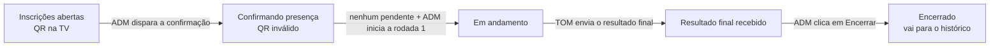
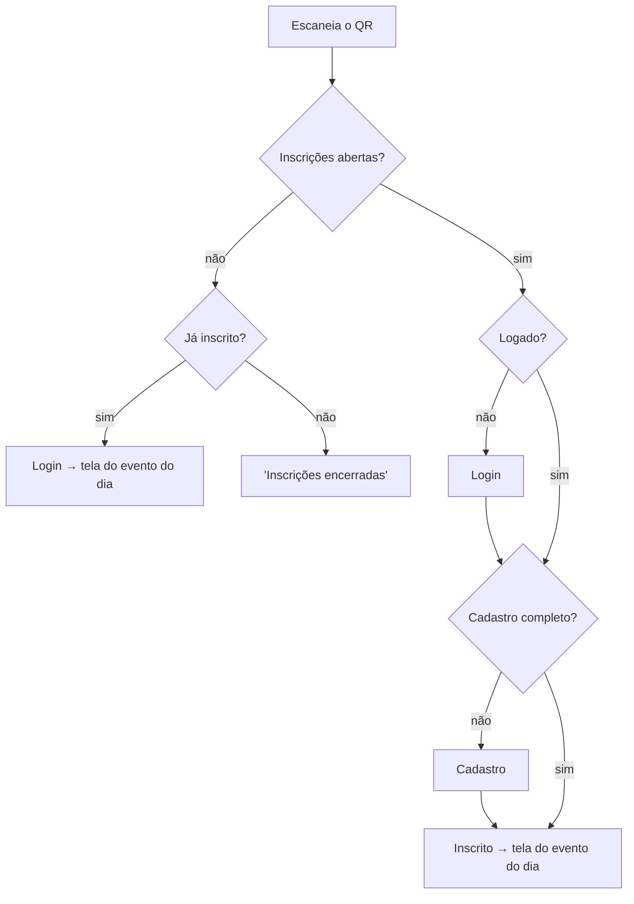

# Spec — Site público, eventos com QR Code, juízes e histórico

Oct 24, 2026 · @Edduardo Souza Figueredo · parte de `docs/spec-tom.md` (fases 0–9 concluídas)

> **Atualização (2026-10-26):** a confirmação de presença saiu. O QR fica aberto até o encerramento e a entrada depois da rodada 1 espera a aprovação do ADM. Ver `2026-10-26-ajustes-testes-design.md`, item 1.

## Por que

Hoje o site inteiro pede login, a inscrição no evento depende do ADM conferir cada Player ID no check-in e o juiz é um grupo no Cognito criado por comando. No dia do evento isso gera fila e trabalho manual. O ADM ainda precisa digitar cada jogador no TOM, um a um, porque o TOM não importa listas.

Esta spec muda seis coisas:

1. **O site é público**, como uma página do GitHub: qualquer pessoa vê sem login, e o login só é necessário para agir.
2. **O ADM cria o evento e o sistema gera um QR Code**, exibido na TV. O jogador escaneia, entra (ou se cadastra) e fica inscrito sozinho.
3. **Confirmação de presença:** antes de lançar no TOM, o ADM pede que todos os inscritos confirmem; assim atrasados e esquecidos não entram na lista.
4. **O ADM recebe a lista de confirmados pronta** (Player ID, nome, ano de nascimento) para digitar no TOM com rapidez.
5. **Login com senha ou conta Google**, sem código por e-mail no dia a dia (o limite de ~50 e-mails/dia do Cognito não comporta 100 jogadores entrando no mesmo dia).
6. **Juiz vira um papel controlado pelo ADM dentro do site**, e o jogador ganha o histórico dos eventos que jogou.

Sucesso: num evento real, ninguém espera o ADM para se inscrever, nenhum e-mail precisa chegar para alguém jogar, e o ADM digita a lista no TOM sem perguntar nada a ninguém.

## Quem pode reportar: o TOM decide

A inscrição pelo QR serve para montar a lista que o ADM digita no TOM; **não** controla o reporte. Continua como hoje: pode reportar quem aparece nas guias do TOM (match_slips) da rodada e tem conta com aquele Player ID.

- Alguém lançado direto no TOM sem passar pelo QR reporta normalmente, se tiver conta com o Player ID.
- Alguém inscrito que não foi lançado no TOM não joga. O painel de inscritos avisa quem está confirmado mas não apareceu nas guias da rodada 1.
- O histórico e o número de participantes saem do TOM, não da lista de inscritos.

## Papéis

| Papel | Quem | Como vira | Player ID |
| --- | --- | --- | --- |
| ADM | Funcionários da loja (hoje 2) | Grupo `admin` no Cognito, por comando (como hoje; README) | Não precisa |
| Juiz | Conta comum marcada pelo ADM na página "Equipe" | Marca permanente na conta, até o ADM tirar | Precisa (é uma conta de jogador) |
| Jogador | Qualquer conta com cadastro completo | Cadastro pelo site | Precisa |

- O grupo `judge` do Cognito deixa de existir; a marca de juiz fica na conta (DynamoDB `Accounts`).
- Ser juiz da equipe não dá poder nenhum sozinho: o juiz só age nos eventos em que foi **escalado** pelo ADM.
- Juiz pode jogar, mas nunca no evento em que está escalado. O sistema recusa: escalar quem já está inscrito, e inscrever pelo QR quem está escalado.
- Juiz e jogador usam **a mesma conta** (o Player ID é único por pessoa e o histórico fica num lugar só). Ao entrar, o juiz vê duas áreas: "Jogador" e "Juiz".

Permissões dentro de um evento (o restante da tabela de papéis de `spec-tom.md` continua valendo):

| Ação | Jogador inscrito | Juiz escalado | ADM |
| --- | --- | --- | --- |
| Reportar pela própria mesa | ✓ | | |
| Override, acréscimo de tempo, ver o painel da rodada | | ✓ | ✓ |
| Reportar em nome de jogador, iniciar rodada, key lançada | | | ✓ |
| Criar, editar e encerrar evento; escalar juízes; ver inscritos; token do enviador | | | ✓ |
| Equipe (marcar/desmarcar juiz), desfazer vínculo de Player ID | | | ✓ |

## Site público

- `/` abre **sem login**: é a home da loja. Nesta spec ela tem só a estrutura (nome da loja e o botão "Entrar"); o conteúdo (redes sociais, fotos, menu de eventos) fica para outra spec.
- Logado, o cabeçalho troca "Entrar" pelo acesso às áreas da pessoa (Jogador, Juiz, ADM, conforme o papel) e "Sair".
- `/tv` continua pública, como hoje.
- Toda ação continua exigindo login na API; ser público vale só para o que é leitura de vitrine.

## Ciclo de vida do evento

Um evento ativo por vez. Para criar outro, o anterior precisa estar encerrado ou cancelado.

**Criar evento (ADM):** nome, data, tempo de rodada (padrão de 30 min) e juízes escalados (escolhidos entre os juízes da equipe). Só TCG; não há campo de formato. Juízes e tempo de rodada podem ser editados enquanto o evento não estiver encerrado. A criação continua gerando o token do enviador, como hoje.

**Inscrições:** abertas da criação até o ADM disparar a confirmação de presença. A partir daí o QR deixa de valer na hora. Atrasados entram só se o ADM inscrever à mão no painel.

**Confirmação de presença:**

- O ADM dispara "Pedir confirmação" no painel do evento. Não há e-mail nem push: a tela do evento de cada inscrito passa a mostrar um aviso grande "Confirme sua presença" com um botão (pela consulta periódica que o celular já faz).
- O painel mostra cada inscrito como confirmado ou pendente, com o contador "15 de 18 confirmados".
- Para quem não confirma (foi embora, sem celular), o ADM **remove** o inscrito ou **confirma por ele**.
- "Iniciar rodada 1" só fica liberado com **nenhum pendente**. O ADM digita os confirmados no TOM, o TOM gera a rodada 1 e o ADM inicia.

**Encerrar:** o botão "Encerrar evento" só aparece depois que o TOM envia o resultado final. Encerrado, o evento entra no histórico dos jogadores e libera a criação do próximo.

**Cancelar:** o ADM pode cancelar o evento a qualquer momento antes de encerrar (com confirmação na tela), para o caso de evento criado por engano ou enviador que nunca enviou o resultado final. Evento cancelado não entra no histórico e libera a criação do próximo.

## QR Code e inscrição

O QR aponta para um endereço do evento no site (ex.: `/e/<código>`), com um código aleatório próprio do evento (não é o token do enviador nem o id interno). O QR é gerado no navegador, sem custo de AWS.

Ao escanear:

- A inscrição acontece sozinha no fim do caminho; não há botão "confirmar inscrição".
- Escanear de novo já inscrito só leva à tela do evento (inscrição é idempotente).
- Juiz escalado no evento que escaneia o QR: recusado, com a mensagem "Você é juiz deste evento".
- O jogador não cancela a inscrição sozinho; o ADM pode remover um inscrito no painel de inscritos. Removido que escaneia de novo, com o QR ainda aberto, vê "Sua inscrição foi removida, procure o ADM"; só o ADM o inscreve de novo.
- O ADM também inscreve à mão (busca por Player ID ou nome), para atrasados e jogadores sem celular.
- Cadastro completo = nome, ano de nascimento, Player ID e os consentimentos de LGPD já existentes (`spec-tom.md`, "Dados pessoais e LGPD"). O formulário de cadastro atual é reaproveitado.

## Login

Sai o login por código enviado ao e-mail. Ficam dois caminhos, ambos no Cognito:

- **E-mail e senha.** O cadastro é confirmado na hora, sem código por e-mail (o e-mail não é verificado; risco aceito: alguém pode digitar o e-mail de outra pessoa). O único e-mail enviado é o de **"Esqueci minha senha"**, com volume baixo, dentro do limite do Cognito; o SES continua em aberto em `spec-tom.md`.
- **Conta Google** (entra nesta spec). O Google só é aceito com e-mail verificado. Passo manual do usuário: criar o cliente OAuth no Google Cloud; o cadastro do provedor no Cognito segue o comando único do README, com o segredo fora do repositório.
- Quem entra pelo Google e também por e-mail e senha continua com **uma conta só**, unificada pelo e-mail (regra atual de `spec-tom.md`). Como o e-mail da senha não é verificado, a ligação automática só acontece quando o Google prova o e-mail; um cadastro com senha num e-mail que já pertence a uma conta Google é recusado ("Esse e-mail já tem conta, entre com o Google").
- **Sessão única e troca de dispositivo** continuam como hoje: entrar num celular novo pede confirmação na tela e desconecta o anterior na hora. A sessão no celular é longa (o jogador não precisa digitar a senha a cada evento).
- Contas atuais, criadas com código por e-mail, definem a senha pelo "Esqueci minha senha" ou entram pelo Google.
- Custo: sem recurso novo; login com senha e Google estão no plano do Cognito já usado (US$ 0 até 10 mil usuários ativos/mês). Se a confirmação automática do cadastro exigir um gatilho Lambda do Cognito, ele roda dentro da franquia da Lambda (US$ 0).

## Player ID sem conferência do ADM

A confirmação presencial do Player ID no check-in **sai**. Decisão do usuário, com o risco aceito: alguém pode cadastrar o Player ID de outra pessoa antes dela.

- O Player ID trava na hora do cadastro: o primeiro a cadastrar fica com ele (hoje a trava só vale depois da confirmação).
- Quem tentar um Player ID já em uso vê "Esse Player ID já está em uso, procure o ADM".
- O ADM tem a ação **"Desfazer vínculo"**: busca o Player ID, tira-o da conta errada (que volta a ficar com cadastro incompleto) e o dono verdadeiro cadastra em seguida. Fica registrado como evento de auditoria (autor, horário, conta afetada). A inscrição da conta errada no evento ativo cai junto; o histórico é guardado por Player ID, então acompanha o dono verdadeiro.
- Contas que hoje têm Player ID pendente passam a valer como cadastradas. Se duas contas tiverem o mesmo Player ID pendente, vale a mais antiga e a outra volta a ficar com cadastro incompleto.
- A tela de check-in atual e o aviso "Check-in pendente" saem.

## TV

| Estado do evento | A TV mostra |
| --- | --- |
| Sem evento ativo | Tela de espera com o nome da loja |
| Inscrições abertas | Tela de espera: nome do evento, **QR Code grande** e contagem de inscritos ao vivo |
| Confirmando presença | Sem QR: "Confirme sua presença no celular" e o contador de confirmados |
| Em andamento | Pareamentos e cronômetro (como hoje) |
| Resultado final recebido / encerrado | Classificação final (standings do TOM) até o próximo evento ser criado |

A troca entre telas é automática, pela mesma consulta periódica que a TV já faz.

## Telas

**Jogador (logado):**

- **Evento do dia:** a tela atual de rodada (mesa, oponente, reporte), mais o estado da inscrição antes de começar ("Inscrito no evento X, aguardando início") e o aviso "Confirme sua presença" quando o ADM pedir.
- **Histórico:** um item por evento encerrado de que participou, com data, número de participantes, campanha (vitórias, derrotas e empates) e colocação final. Sem premiações. Os dados saem das fotografias do TOM já guardadas. No encerramento, o sistema grava um resumo por Player ID: standings e matchrecord trazem só nomes, então o nome é ligado ao Player ID pelas guias (match_slips) do mesmo torneio. Nome repetido no mesmo torneio que as guias não desambiguam fica fora do histórico desses jogadores, e o ADM é avisado.

**Juiz (logado):** lista dos eventos em que está escalado; no evento em andamento, o painel da rodada atual com as ações de juiz. Fora deles, nenhum poder.

**ADM (logado):**

- **Evento:** criar/editar, ver o QR, token do enviador, pedir confirmação, iniciar rodada, encerrar, cancelar.
- **Inscritos:** lista em ordem de inscrição com Player ID, nome e ano de nascimento, atualizada sozinha. Cada linha tem botão de copiar (Player ID e nome), o estado da confirmação (com "confirmar por ele"), a marcação "lançado no TOM" e a opção de remover; no topo, os contadores "15 de 18 confirmados" e "12 de 15 lançados", e o botão de inscrever à mão. Depois da rodada 1, avisa quem estava confirmado e não apareceu nas guias do TOM.
- **Painel da rodada:** o painel atual (fase 9), sem a confirmação de Player ID.
- **Equipe:** busca conta por Player ID ou nome; marca/desmarca juiz; "Desfazer vínculo" de Player ID.

## Objetivos, fora de escopo e o que não pode acontecer

Fora desta spec:

- Conteúdo da home (redes sociais, fotos, menu de eventos).
- Premiações no histórico.
- Vários eventos ativos ao mesmo tempo.
- Formatos além de TCG.
- Tela para criar ADM (continua por comando).
- Notificação push e e-mail na confirmação de presença.
- Estética das telas e SES (seguem em aberto em `spec-tom.md`).

Não pode acontecer:

- O QR continuar aceitando inscrição depois de o ADM pedir a confirmação.
- Alguém deixar de jogar porque um e-mail não chegou.
- A rodada 1 começar com inscrito pendente de confirmação.
- Um juiz agir num evento em que não está escalado, ou jogar e julgar o mesmo evento.
- Um visitante sem login conseguir executar qualquer ação, ou ver dados pessoais (e-mail, ano de nascimento, Player ID) de alguém.
- A TV mostrar o QR de um evento cujas inscrições já fecharam.

## Restrições

- Tudo da spec principal continua valendo: TypeScript de ponta a ponta, domínio sem AWS, custo como critério principal (ideal zero), us-east-2, uma funcionalidade por vez, testada antes da próxima.
- Nenhum recurso AWS novo é esperado: os dados novos (estado do evento, inscrições, escala de juízes, marca de juiz, "lançado no TOM") cabem nas tabelas atuais. Se o construtor precisar de um recurso novo, ele vem com a diferença de custo e a projeção.
- A TV e o painel de inscritos usam consulta periódica, como o resto do sistema. O endpoint público do quadro da TV já tem cache de 5 s no CloudFront; o estado do evento (QR, contagem) pode seguir o mesmo caminho.

## Decisões do construtor

Ficam a critério de quem implementa, desde que sigam a spec:

- Formato e tamanho do código do evento no QR, e a biblioteca de QR (a menor que resolva).
- Nomes das rotas (`/`, `/e/<código>`, áreas de jogador, juiz e ADM) e como reorganizar `home.tsx`, `checkin.tsx` e o roteamento atual.
- Modelagem no DynamoDB (itens novos nas tabelas `Tournaments` e `Accounts`).
- Como detectar "resultado final recebido" a partir dos HTMLs do TOM (ex.: standings da última rodada prevista em `tournament_details`).
- Divisão em fases, desde que cada fase entregue algo testável.

## Decisões tomadas por mim (para conferir)

Pontos que o usuário não decidiu explicitamente; marquei como padrão sensato:

- O jogador não cancela a inscrição sozinho; o ADM remove, e o removido só volta pelas mãos do ADM.
- Juízes e tempo de rodada são editáveis até o encerramento.
- A TV mostra a classificação final depois do evento, e uma tela de espera quando não há evento.
- O QR usa um código próprio do evento, separado do token do enviador.
- Contas com Player ID pendente passam a valer; em conflito, vale a mais antiga.
- O ADM pode cancelar o evento a qualquer momento antes de encerrar; cancelado não entra no histórico.
- Histórico guardado por Player ID, com resumo gravado no encerramento; homônimos não desambiguáveis ficam fora e o ADM é avisado.
- "Desfazer vínculo" derruba a inscrição da conta errada no evento ativo.
- Cadastro com senha num e-mail que já tem conta Google é recusado (sem e-mail verificado, não dá para ligar com segurança).
- Contas atuais definem a senha pelo "Esqueci minha senha".
